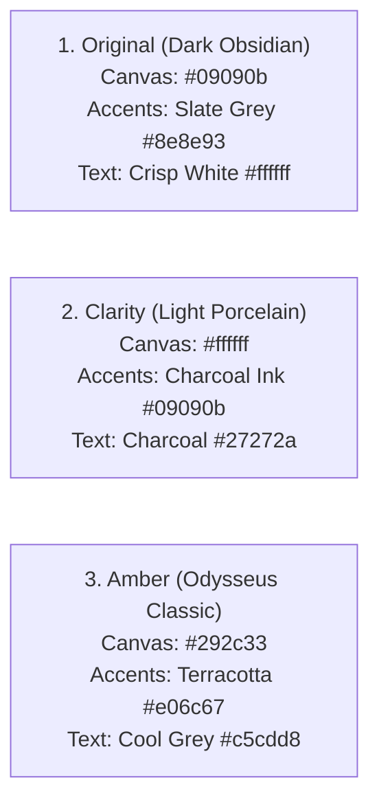

# ScholarsMate: UI/UX Design System & Frontend Architectural Rules

> **Version**: 2.0.1 (checked against the code on 2026-11-25)  
> **Target Environment**: React 19, Vite, Tailwind CSS v4, Lucide Icons, KaTeX, Docx  
> **Brand Identity**: *"YOUR RESEARCH, CHECKMATED."*
>
> Items marked **Not built yet** are planned behaviour from the roadmap in `ScholarsMate.md` §4, not the current app.

---

## 1. Visual Identity & Brand Philosophy

ScholarsMate embodies the precision, intellect, and discipline of grandmaster chess fused with state-of-the-art scholarly research engineering.

* **Chess Motif**: The pawn (`ChessPawn`), knight, rook, and king are utilized as structural visual cues. The pawn represents academic rigor—advancing step-by-step toward publication.
* **Palette Aesthetic**: Dark obsidian canvases (`#09090b`), surgical slate grey borders (`#27272a`), signature neutral slate grey accents (`#8e8e93`), and pure crisp white typography (`#ffffff`).
* **Aesthetic Influences**: 
  * Linear.app & VS Code (for dense information hierarchy, keyboard efficiency, and precision micro-interactions).
  * Zotero (for bibliographic depth and tree collection workflows).
  * Overleaf & Microsoft Word (for distraction-free, publication-grade academic document authoring).
  * ChatGPT & Claude (for conversational naturalness and streaming feedback).

---

## 2. Theme System & Dynamic Token Architecture

ScholarsMate features a tripartite theme engine managed through CSS variables and Tailwind CSS tokens (`frontend/src/index.css` & `frontend/src/theme/constants.jsx`).

### 2.1. The Three Canonical Themes



1. **Original (`data-theme="original"`) — Default**:
   * `--theme-canvas`: `#09090b` (Deep obsidian black).
   * `--theme-surface`: `#121215` (Elevated card & sidebar surface).
   * `--theme-elevated`: `#1a1a1e` (Hover & modal background).
   * `--theme-border`: `#27272a` (Subtle boundary line).
   * `--theme-brand-grey`: `#8e8e93` (Signature slate grey).
   * `--theme-text-bold`: `#ffffff` (Headings & primary actions).
   * `--theme-text-body`: `#d4d4d8` (Reading body copy).
   * `--theme-text-muted`: `#8e8e93` (Subtitles, labels, metadata).

2. **Clarity (`data-theme="clarity"`) — High-Legibility Light Mode**:
   * `--theme-canvas`: `#ffffff` (Crisp daylight porcelain).
   * `--theme-surface`: `#f4f4f5` (Cool grey sidebar and card backgrounds).
   * `--theme-elevated`: `#e4e4e7` (Input fields & borders).
   * `--theme-border`: `#e4e4e7` (Boundary line).
   * `--theme-text-bold`: `#09090b` (Jet-black ink).
   * `--theme-text-body`: `#27272a` (Charcoal body copy).
   * `--theme-text-muted`: `#52525b` (Neutral secondary copy).

3. **Amber (`data-theme="amber"`) — Odysseus Heritage Mode**:
   * `--theme-canvas`: `#292c33` (Warm slate dark background).
   * `--theme-surface`: `#111216` (Deep slate panels).
   * `--theme-elevated`: `#1b1e25` (Hover & modal background).
   * `--theme-accent-primary`: `#e06c67` (Vibrant terracotta coral).
   * `--theme-border`: `#27272a` (Subtle boundary line).
   * `--theme-text-bold`: `#ffffff`, `--theme-text-body`: `#c5cdd8`, `--theme-text-muted`: `#9aa3b2`.

The theme picker (`constants.jsx`) offers only these three. `index.css` also maps 28 legacy theme names (e.g. `dark`, `midnight`, `light`, `paper`) onto the Original and Clarity token sets.

### 2.2. Typography Tokens
* **Serif Headings & Academic Text**: `'EB Garamond'`, `'Source Serif 4'`, `'Merriweather'`, Georgia, serif.
* **Modern Interface Sans**: `'Source Sans 3'`, `'DM Sans'`, system-ui, sans-serif.
* **Code & Monospace Figures**: `'JetBrains Mono'`, `'Fira Code'`, monospace.
* **Math Rendering**: KaTeX math formulas styled with crisp white inline equations (`$`) and display blocks (`$$`).
* **Font loading gap**: `index.html` loads EB Garamond, Source Serif 4, Merriweather, Inter and JetBrains Mono from Google Fonts. Source Sans 3, DM Sans and Fira Code are not loaded, so the interface sans stack currently falls back to system fonts.

---

## 3. Layout Structure & Window Rules

The application uses an ultra-responsive, modular canvas structure designed for dual-screen productivity.

```
+----------------------------------------------------------------------------------------------------+
| TOP NAVIGATION BAR (Height: 40px, VS Code style)                                                   |
| [Pawn Logo] ScholarsMate  | [Cmd+K Search Palette (320px)] | [Theme] [Settings] [BYOK Key] [User]  |
+-----------+---------------------------------------------------+------------------------------------+
| SIDEBAR   | MAIN WORKBENCH CANVAS                             | SPLIT-SCREEN RIGHT CANVAS          |
| (256px or | (Flexible 50% or 100%)                            | (50% Split or Fullscreen)          |
| Collapsed |                                                   |                                    |
| 64px)     | * Chat Interface (Stream & Citations)             | * PDF Viewer (Page-exact jumps)    |
|           | * OR Full-Page Zotero Library (/library)          | * OR Document Writer (/writer)     |
| * Workspace| * OR Full-Page Document Writer (/writer)         | * OR Lit Review Studio Monograph   |
|   Tree    | * OR Modern Homepage Showcase (/home)             | * OR Library Slide-over Drawer     |
| * Standalone|                                                 |                                    |
|   Chats   |                                                   |                                    |
| * Tools   |                                                   |                                    |
+-----------+---------------------------------------------------+------------------------------------+
```

### 3.1. Top Navigation Bar (Header)
* Fixed height: `40px` (`h-10`).
* Pinned to top with `z-30`, border bottom `border-zinc-800` (`layout/TopNavbar.jsx`).
* Contains:
  1. Brand Lockup (`AppLogo` + `BrandName`).
  2. Global Command Palette input trigger with `Ctrl+K` / `Cmd+K` keyboard shortcut.
  3. Action cluster: Theme cycler (Moon/Sun), Settings & BYOK API Key inspector, Profile/Auth badge.

### 3.2. Left Navigation Sidebar (`DocumentSidebar.jsx`)
* **Expanded Width**: `256px` (`w-64`).
* **Collapsed Width**: `64px` (`w-16`).
* State is persisted across browser refreshes via `localStorage.getItem('scholarsmate_sidebar_collapsed')`.
* Sections:
  1. **Quick Navigation Switcher**: Home (`/home`), Chat (`/chat`), Library (`/library`), Document Writer (`/writer`).
  2. **Workspaces Tree**: Grouped projects with document counters and a strict limit of 3 active chats per workspace.
  3. **Standalone Chat History**: Unscoped general academic research threads.
  4. **Workspace Actions**: "New Workspace", "Upload Papers", "Literature Review Studio", "Brain Memory".

### 3.3. Main Canvas & Split Screen Rules
* When **Chat Only**: Chat interface expands to `w-full`.
* When **Split Mode** (PDF Viewer, Document Writer, or Literature Review active):
  * Left Canvas shrinks to `w-1/2` with a right border `border-r border-zinc-800`.
  * Right Canvas renders the secondary tool at `w-1/2`.
* **Fullscreen Mode (100vw × 100vh)**:
  * Floating expand button (`ChevronLeft` / `Maximize2`) collapses the chat and sidebar completely, providing an unconstrained 100vw distraction-free authoring or reading view.

---

## 4. UI/UX Rules for the Three Core Pillars

### 4.1. Pillar 1: Chat & Research Canvas Rules
1. **Generation Feedback**:
   * Responses are not streamed: `POST /api/query` returns the whole answer at once. While a request runs, the chat shows the pulsating ChessPieceLoader.
   * **Not built yet (Phase 1):** the submit button morphs into a Stop button while a request is running.
2. **Citation Rendering**:
   * In-text citations must render as interactive badges: `[DocName, p. X]`.
   * Clicking a citation badge immediately opens the split-screen PDF Viewer and jumps directly to page `X`.
3. **Action Strips**:
   * Assistant messages have a one-click copy action (multi-format clipboard copy, `ChatMessage.jsx`).
   * The whole chat can be exported as Markdown.
   * **Not built yet (Phase 1):** separate LaTeX formula copy, "Try Again" / Regenerate, and a fact-check feedback flag.
4. **Research Mode Indicators**:
   * Clear visual indicator for `/paper` (Strict Document RAG, 100% grounded) vs `/general` (Hybrid Research Companion).

### 4.2. Pillar 2: Zotero-Style Reference Library Rules
1. **Three-Pane Architecture**:
   * Left, top to bottom: *My Library*; smart collections (*Unfiled* = in no folder, *Recent* = the 50 newest, *Has PDF*, *Duplicates*); *Folders*, a nested tree (`FolderTree.jsx`); *Workspaces*, which are what scope RAG in chat; tags.
   * Center: Sortable bibliographic data table with columns (Title, Authors, Year, Venue, Workspace Link, Actions).
   * Right: Comprehensive metadata inspector (`LibraryInspector.jsx`) displaying abstract, DOI, BibTeX, and notes.
2. **File System & Workspace Co-existence** (built in W4B; folders are organisation only):
   * Organizing papers into folders must **never** break or displace Workspace vector embeddings.
   * Papers can belong to multiple folders and simultaneously be linked to one or more active Workspaces.
   * Dragging rows onto a folder files them; dragging onto a workspace assigns them (and does change RAG scope). Folders can be dragged onto folders, and every action has a keyboard route ("Add to folder…", "Move to…"). Deleting a folder never deletes papers.
3. **Quick-Access Mode**:
   * Must be usable as a full-page view (`/library`) AND as a slide-over drawer inside `/chat`.
   * The full-page view exists. The chat drawer is `LibraryView` in `compact` mode (W4B): Title and Year columns only, the inspector opens as an overlay, and papers can be added to the chat's workspace.

### 4.3. Pillar 3: MS Word-Style Document Writer Rules
1. **Strict Text & Tables Focus**:
   * Visual canvas must look and feel like Microsoft Word or Google Docs (centered page with margins and drop shadow).
   * Current page: US Letter, 816 × 1056 px (`.word-document-canvas` in `index.css`), with about 32–44 px padding rather than 1-inch margins. There is no A4 option, though code comments call it A4.
   * Focus exclusively on publication text formatting and academic tables. (No complex floating graphics or shapes).
2. **Dual-Engine Citation UX**:
   * Text selection opens a floating menu with cite actions (`FloatingBubbleMenu.jsx`).
   * **Manual Mode** (`LibraryCitationDrawer.jsx`): Search library references, select style (IEEE, APA 7, Harvard), pick page number, insert in-text citation. A References list is built at PDF export. **Not built yet:** Chicago style.
   * **AI-Assisted Mode** (`CitationDrawer.jsx`): Embeds selected claim, finds top ChromaDB chunks, displays **similarity percentage badge** (e.g. `94% Match`), and allows 1-click grounded citation insertion.
   * The two modes are separate drawers today; unifying them into one drawer is Phase 2.

---

## 5. Frontend Development & Code Quality Rules

1. **Component Modularity**:
   * All components live in dedicated domain directories under `frontend/src/components/`:
     * `chat/` — ChatInterface, ChatMessage, ChatInput, ChatSidebar, QueryNavigator, WorkspaceLoadingState.
     * `common/` — AppLogo, BrandName, ChessPieceLoader, ErrorBoundary, ScholarsMateIntro.
     * `document/` — DocumentSidebar, DocumentSelector, CreateWorkspaceModal.
     * `home/` — HomeView.
     * `layout/` — TopNavbar, Header, AuthProfile, SettingsModal, ProfileSettingsModal.
     * `library/` — LibraryView, LibraryInspector, DuplicateMerger, FolderTree, folderTreeUtils (pure tree and smart-collection helpers, tested with `node --test`).
     * `modals/` — GlobalSearchModal, LiteratureReviewModal, ThemeModal, BrainModal, AuthModal, CustomLensModal, NewChatModal, PromptInspectorModal.
     * `theme/` — AnimatedThemeCanvas.
     * `viewer/` — PdfViewer.
     * `writer/` — DocumentWriter, CitationDrawer, LibraryCitationDrawer, FloatingBubbleMenu, InlineAskAIDrawer.
2. **State Management & URL Synchronization**:
   * URL routes (`/home`, `/chat`, `/library`, `/writer`) must stay synchronized using `window.history.pushState` and popstate listeners without full page reloads.
3. **BYOK Security Hygiene**:
   * API keys (Groq, OpenAI, Anthropic, Gemini, OpenRouter) must remain strictly in `localStorage`, under `scholarsmate_byok_keys` and `scholarsmate_byok_key_items`.
   * Never store API keys in plaintext backend logs, git commits, or unauthenticated endpoints.
4. **Keyboard Accessibility**:
   * Global `Cmd+K` / `Ctrl+K`: Opens Global Search Palette.
   * Global `Escape`: Closes active modals and slide-over drawers.
   * `Enter` (without Shift): Submits chat prompts or citation search.
   * `Shift+Enter`: Inserts newline in prompt input.
5. **Defensive Error Handling**:
   * All heavy views (PDF Viewer, Document Writer, Literature Review) must be wrapped in `<ErrorBoundary>` to prevent app crashes from corrupt PDFs or malformed LaTeX.
   * Currently wrapped: the split-screen PDF Viewer (`App.jsx`) and the app root (`main.jsx`). **Gap:** the Document Writer and Literature Review are not wrapped, so an error in either falls through to the app-wide boundary.
