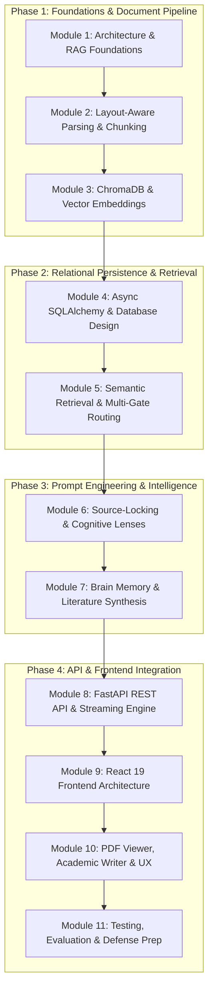

# ScholarsMate 🎓 — Full-Stack Academic RAG Masterclass Curriculum

Welcome to the **ScholarsMate Full Course Curriculum**. This curriculum is structured as a self-paced, progressive engineering course designed to take you from core computer science and RAG fundamentals all the way to complex full-stack implementation across backend, vector storage, autonomous memory, and frontend UI.

---

## 🧭 Course Strategy: Feature-by-Feature (Layered Flow) vs. File-by-File

> [!TIP]
> **Why the Feature-by-Feature approach is used here:**
> A purely "file-by-file" approach breaks down in real-world full-stack systems. For instance, `backend/api/main.py` is over 1,000 lines long and touches authentication, vector search, drafting, streaming, and background workers all at once. Trying to understand it on Day 1 causes cognitive overload.
>
> Instead, this course follows the **Data & Intent Lifecycle (Feature-by-Feature)**:
> 1. **Ingestion & Data Flow** (How a physical PDF becomes clean, structured semantic chunks)
> 2. **Vector Space & Embeddings** (How text converts into mathematical coordinates in ChromaDB)
> 3. **Relational State** (How users, chat sessions, drafts, and memories persist in SQLite/PostgreSQL)
> 4. **Retrieval & Intent Routing** (How user questions are classified and filtered)
> 5. **Generation & Grounding** (How source-locking and cognitive modes prevent AI hallucinations)
> 6. **Advanced Intelligence** (Autonomous Brain Memory & Map-Reduce Literature Synthesis)
> 7. **FastAPI Web Layer** (How REST endpoints glue the backend together)
> 8. **Frontend System & Split-Screen UX** (React 19, Vite, PDF syncing, and the Academic Writer)

Every lesson is paired with **exact file paths, code symbols, architectural explanations, and hands-on checkpoints**.

---

## 🗺️ Curriculum Roadmap Overview



---

## 📚 Module 1: Architecture & RAG Foundations

### Lesson 1.1: The Core Problem — Academic Hallucinations vs. Source-Locked RAG
- **Conceptual Grounding:**
  - Why standard LLMs (ChatGPT, Claude) cannot be trusted for scientific literature (citation fabrication, phantom papers, conflating methodologies).
  - The Retrieval-Augmented Generation (RAG) paradigm: *Retrieve first, ground context second, synthesize third*.
  - What "Source-Locked" means: The model is strictly constrained to generate assertions backed by page-verifiable evidence.
- **Code Tour:**
  - Read [README.md](file:///run/media/bihhlal/Shared/Uni/ScholarsMate/README.md) and [docs/development/roadmap.md](file:///run/media/bihhlal/Shared/Uni/ScholarsMate/docs/development/roadmap.md).
- **Key Concepts:** Retrieval-Augmented Generation, Groundedness, Hallucination Elimination, Page-Level Provenance.
- **Checkpoint / Exercise:** Explain in two sentences why passing an entire 50-page PDF to a vanilla prompt is inferior to chunked vector retrieval.

---

### Lesson 1.2: End-to-End System Blueprint & Tech Stack Rationale
- **Conceptual Grounding:**
  - The request lifecycle: PDF Upload ➔ Layout Extraction ➔ Semantic Chunking ➔ Embedding ➔ ChromaDB.
  - The query lifecycle: User Query ➔ Intent Classifier ➔ Semantic Search ➔ System Prompt Assembly ➔ Model Execution ➔ Frontend Citation Mapping.
- **Technology Choices:**
  - **Backend:** Python 3.12, FastAPI (high-throughput async ASGI), PyMuPDF (C-speed PDF parsing), ChromaDB (lightweight local vector store), SQLAlchemy 2.0 + aiosqlite (async relational database), LiteLLM (unified BYOK provider gateway).
  - **Frontend:** React 19, Vite, Tailwind CSS v4, Lucide React, React-PDF, KaTeX (LaTeX math).
- **Code Tour:**
  - Inspect [requirements.txt](file:///run/media/bihhlal/Shared/Uni/ScholarsMate/requirements.txt) and [frontend/package.json](file:///run/media/bihhlal/Shared/Uni/ScholarsMate/frontend/package.json).

---

## 📚 Module 2: Document Ingestion & Layout-Aware Parsing

### Lesson 2.1: PDF Extraction with PyMuPDF
- **Conceptual Grounding:**
  - Why standard text extraction (`pypdf`, `pdfplumber`) fails on multi-column academic papers (reading across columns horizontally, scrambled tables).
  - PyMuPDF (`fitz`) block extraction: Sorting text blocks topologically by physical reading order (`b[6] == 0` filters out images/drawings).
- **Code Walkthrough:**
  - File: [`backend/ingestion/pdf_parser.py`](file:///run/media/bihhlal/Shared/Uni/ScholarsMate/backend/ingestion/pdf_parser.py)
  - Function: `parse_pdf(pdf_path: str)`
  - File: [`backend/ingestion/pipeline.py`](file:///run/media/bihhlal/Shared/Uni/ScholarsMate/backend/ingestion/pipeline.py#L21-L60)
  - Function: `extract_pages_layout_aware(pdf_path: str, file_hash: str)`
- **Hands-on Task:** Run `python backend/ingestion/pdf_parser.py <path-to-sample.pdf>` and inspect how page metadata and text blocks are returned.

---

### Lesson 2.2: Bibliographic Metadata Extraction
- **Conceptual Grounding:**
  - Extracting paper titles, authors, publication years, and DOIs directly from the paper's first page and headers.
  - Regular expression patterns for academic metadata (arXiv IDs, DOIs like `10.xxxx/...`, author lines).
- **Code Walkthrough:**
  - File: [`backend/ingestion/bibliographic_extractor.py`](file:///run/media/bihhlal/Shared/Uni/ScholarsMate/backend/ingestion/bibliographic_extractor.py)
  - Function: `extract_bibliographic_metadata(pdf_path: str)`
- **Key Takeaway:** How metadata extracted here is attached to every downstream chunk for automated citation formatting (e.g. `(Vaswani et al., 2017)`).

---

### Lesson 2.3: Semantic Chunking & Citation Tagging
- **Conceptual Grounding:**
  - Why chunk size matters: Too small = loss of context; too large = diluted vector similarity and token bloat.
  - Overlap mechanics: Ensuring sentences split across chunk boundaries do not lose semantic coherence.
  - Citation tags: Building deterministic chunk IDs in format `doc_name::p<page_number>::<chunk_index>`.
- **Code Walkthrough:**
  - File: [`backend/ingestion/text_chunker.py`](file:///run/media/bihhlal/Shared/Uni/ScholarsMate/backend/ingestion/text_chunker.py)
  - Function: `chunk_documents(documents, chunk_size=1000, chunk_overlap=100)`
- **Key Concepts:** `RecursiveCharacterTextSplitter`, separator hierarchies (`\n``` `, `\n\n`, `\n`, ` `), 1-based page index normalization.

---

### Lesson 2.4: Deduplication & Tier-1 Summary Caching
- **Conceptual Grounding:**
  - Deduplication via SHA-256: Preventing re-indexing the same PDF multiple times.
  - Tier-1 Summary Worker: Generating and caching an executive 150-word paper abstract on upload for instant queries without vector search.
- **Code Walkthrough:**
  - File: [`backend/ingestion/pipeline.py`](file:///run/media/bihhlal/Shared/Uni/ScholarsMate/backend/ingestion/pipeline.py#L9-L16) (`calculate_sha256`)
  - File: [`backend/ingestion/summary_worker.py`](file:///run/media/bihhlal/Shared/Uni/ScholarsMate/backend/ingestion/summary_worker.py)
  - Function: `generate_document_summary()`, `trigger_async_summary_generation()`
- **Hands-on Task:** Trace how `trigger_async_summary_generation` runs in a background thread so the user gets an immediate upload response.

---

## 📚 Module 3: Vector Embeddings & Local Storage (ChromaDB)

### Lesson 3.1: Dense Vector Embeddings & Cosine Distance
- **Conceptual Grounding:**
  - What is an embedding? Mapping natural language strings into high-dimensional space ($R^{384}$ or $R^{768}$) where semantic similarity equals vector proximity.
  - Sentence Transformers (`all-MiniLM-L6-v2` or `sentence-transformers/all-mpnet-base-v2`): Speed vs quality tradeoffs.
  - Distance metrics: Cosine distance vs. Euclidean distance vs. Dot product.
- **Code Walkthrough:**
  - File: [`backend/embeddings/vector_store.py`](file:///run/media/bihhlal/Shared/Uni/ScholarsMate/backend/embeddings/vector_store.py)
  - Embedding function configuration: `DefaultEmbeddingFunction` / `sentence_transformers`.

---

### Lesson 3.2: ChromaDB Collections & Persistence
- **Conceptual Grounding:**
  - How ChromaDB acts as an embedded vector database storing embeddings, raw documents, and metadata payloads in SQLite + DuckDB/parquet.
  - Persistent storage directories (`/chroma_db`).
- **Code Walkthrough:**
  - File: [`backend/embeddings/vector_store.py`](file:///run/media/bihhlal/Shared/Uni/ScholarsMate/backend/embeddings/vector_store.py)
  - Functions:
    - `get_or_create_collection(collection_name)`
    - `store_chunks(chunks, collection_name)`
    - `list_indexed_documents()`
    - `is_document_already_indexed(file_hash)`

---

### Lesson 3.3: Filtered Vector Search & Metadata Queries
- **Conceptual Grounding:**
  - Exact document isolation: Searching *only* inside selected documents using Chroma's `$in` and `where` metadata clauses.
  - Top-K retrieval: Fetching the $K$ nearest chunks with their associated similarity distances.
- **Code Walkthrough:**
  - File: [`backend/embeddings/vector_store.py`](file:///run/media/bihhlal/Shared/Uni/ScholarsMate/backend/embeddings/vector_store.py)
  - Function: `search_similar_chunks(query, doc_names, top_k)`
- **Hands-on Task:** Write a small script calling `search_similar_chunks("transformer attention", top_k=3)` and print the chunk text and distance.

---

## 📚 Module 4: Relational Persistence (SQLAlchemy 2.0 Async ORM + SQLite)

### Lesson 4.1: Database Schema & Entity Relationships
- **Conceptual Grounding:**
  - Why a vector database is not enough: Relational data (users, sessions, messages, drafts, memories) needs ACID compliance, relational integrity, and cascading deletions.
- **Schema Deep Dive:**
  - File: [`backend/db/models.py`](file:///run/media/bihhlal/Shared/Uni/ScholarsMate/backend/db/models.py)
  - **`User`**: OAuth/Guest accounts, avatar, timestamps.
  - **`UserDocument`**: Tracks uploaded PDFs, SHA-256 hashes, and Tier-1 summary cache.
  - **`ChatSession`**: Workspace chat threads with selected `doc_names` and `active_mode`.
  - **`ChatMessage`**: Messages with `sender` ("user"/"bot"), `thinking_process` (reasoning traces), `sources_used`, and telemetry metadata.
  - **`WorkspaceDraft`**: Persisted academic writing drafts (HTML & Markdown).
  - **`BrainMemory`**: Persistent learned user profiles, preferences, and project milestones.

---

### Lesson 4.2: Asynchronous Database Sessions with `aiosqlite`
- **Conceptual Grounding:**
  - Why async DB operations prevent blocking FastAPI's single-threaded event loop.
  - SQLAlchemy 2.0 `async_sessionmaker`, `AsyncSession`, and dependency injection in FastAPI.
- **Code Walkthrough:**
  - File: [`backend/db/session.py`](file:///run/media/bihhlal/Shared/Uni/ScholarsMate/backend/db/session.py)
  - Functions: `init_db()`, `get_db()`.
- **Key Concepts:** `yield db`, automatic session rollback on exceptions, lifespan connection pooling.

---

### Lesson 4.3: CRUD Operations & Query Optimization
- **Conceptual Grounding:**
  - Clean separation of concerns: Keeping raw SQL / ORM logic out of API route handlers.
- **Code Walkthrough:**
  - File: [`backend/db/crud.py`](file:///run/media/bihhlal/Shared/Uni/ScholarsMate/backend/db/crud.py)
  - Functions:
    - `get_or_create_user()`
    - `create_chat_session()`, `get_user_sessions()`, `delete_chat_session()`
    - `append_chat_message()`
    - `save_workspace_draft()`, `get_workspace_draft()`
    - `get_brain_memories()`, `create_brain_memory()`, `deactivate_brain_memory()`

---

## 📚 Module 5: Semantic Retrieval & Multi-Gate Intent Routing

### Lesson 5.1: Query Intent Classification & Fast-Paths
- **Conceptual Grounding:**
  - Why running vector search on every prompt is wasteful and slow (e.g. "Hello", "Thanks", "What documents are uploaded?").
  - Fast-Path 1: Metadata queries (bypasses vector DB, inspects indexed catalog).
  - Fast-Path 2: Instant cached summary retrieval (bypasses LLM generation if summary exists).
  - Fast-Path 3: Conversational greetings & pauses.
- **Code Walkthrough:**
  - File: [`backend/rag/router.py`](file:///run/media/bihhlal/Shared/Uni/ScholarsMate/backend/rag/router.py)
  - Function: `classify_query_intent(query, available_docs, chat_history, model_name, custom_keys)`

---

### Lesson 5.2: Entity Resolution & Target Document Isolation
- **Conceptual Grounding:**
  - Matching user mentions: Handling `@attention.pdf`, fuzzy typos, partial stems (e.g. "in the ResNet paper"), and avoiding substring collisions (e.g., `sample` vs `sample2`).
- **Code Walkthrough:**
  - File: [`backend/rag/router.py`](file:///run/media/bihhlal/Shared/Uni/ScholarsMate/backend/rag/router.py#L44-L113)
  - Function: `resolve_target_documents(query, available_docs, cutoff=0.6)`
  - Regex tokenization, `difflib.get_close_matches`.

---

### Lesson 5.3: Context Assembly & Distance Thresholding (3-Gate Quality)
- **Conceptual Grounding:**
  - Gate 1: Intent Routing (Module 5.1).
  - Gate 2: Vector Distance Thresholding — Dropping irrelevant noise chunks before prompt injection.
  - Gate 3: Context block assembly with explicit citation markers: `--- START OF SOURCE: [Doc_Name, p.X] ---`.
- **Code Walkthrough:**
  - File: [`backend/rag/retriever.py`](file:///run/media/bihhlal/Shared/Uni/ScholarsMate/backend/rag/retriever.py)
  - Functions: `retrieve_context()`, `build_context_block()`.

---

## 📚 Module 6: Generation, Cognitive Lenses & Source-Locked Prompting

### Lesson 6.1: Source-Locked Prompting Directives
- **Conceptual Grounding:**
  - System prompt engineering to eliminate hallucinations:
    1. *Strict grounding rule:* "Never assume or extrapolate beyond retrieved text."
    2. *Mandatory attribution:* Every factual assertion must end with `[Doc_Name, p.X]`.
    3. *Refusal rule:* "If the context does not contain the answer, explicitly state that the documents do not provide this information."
- **Code Walkthrough:**
  - File: [`backend/rag/prompt_templates.py`](file:///run/media/bihhlal/Shared/Uni/ScholarsMate/backend/rag/prompt_templates.py)
  - Constants: `SOURCE_LOCKED_SYSTEM_PROMPT`, `construct_prompt()`, `build_conversation_messages()`.

---

### Lesson 6.2: Academic Cognitive Modes (Lenses)
- **Conceptual Grounding:**
  - Tailoring LLM behavior to specific research workflows:
    - **Paper Assistant (`assistant`):** Balanced, clear, accessible answers with clean citations.
    - **Deep Research (`research`):** Publication-grade rigor, comparative Markdown tables, quantitative metrics, zero conversational fluff ($T=0.0$).
    - **Masterclass Teacher (`teacher`):** Socratic method, 3Blue1Brown motivated discovery, diagnostic checks, verifying foundational understanding before advancing.
- **Code Walkthrough:**
  - File: [`backend/rag/modes.py`](file:///run/media/bihhlal/Shared/Uni/ScholarsMate/backend/rag/modes.py)
  - Dictionary: `ACADEMIC_MODES`, parameter presets (temperature, `top_k`, slash commands).

---

### Lesson 6.3: Multi-Model Gateway & Dynamic Fallback Chains (BYOK)
- **Conceptual Grounding:**
  - Bring-Your-Own-Key (BYOK) architecture: Allowing users to supply API keys for Google Gemini, Groq, OpenAI, Anthropic, or local Ollama.
  - Graceful degradation & fallback chains: If Gemini 2.5 times out or hits rate limits, automatically falling back to Gemini 3.6 or Groq without crashing the user session.
- **Code Walkthrough:**
  - File: [`backend/rag/generator.py`](file:///run/media/bihhlal/Shared/Uni/ScholarsMate/backend/rag/generator.py#L52-L140)
  - Function: `_execute_completion_with_fallback()`
  - File: [`backend/rag/runtime.py`](file:///run/media/bihhlal/Shared/Uni/ScholarsMate/backend/rag/runtime.py)
  - Function: `extract_reasoning_and_content()`, `normalize_litellm_model_id()`.

---

## 📚 Module 7: Autonomous Brain Memory & Literature Synthesis

### Lesson 7.1: Autonomous Brain Memory Engine
- **Conceptual Grounding:**
  - Why standard chat threads suffer from amnesia: Context windows expire; opening a new chat loses user preferences (degree level, preferred citation styles, ongoing thesis topics).
  - Two-tier memory architecture:
    - **Global Scope:** User background (e.g. "Undergraduate working on BS CS Final Year Project"), citation style preferences (IEEE).
    - **Workspace Scope:** Project-specific insights, benchmark conclusions, methodology decisions.
  - Asynchronous background extraction: After every dialogue turn, an async task analyzes the exchange, extracts atomic declarative facts into JSON, and persists them to the database.
- **Code Walkthrough:**
  - File: [`backend/rag/brain.py`](file:///run/media/bihhlal/Shared/Uni/ScholarsMate/backend/rag/brain.py)
  - Functions: `build_brain_context()`, `extract_and_persist_memories_async()`, `BRAIN_EXTRACTION_PROMPT`.

---

### Lesson 7.2: Multi-Paper Map-Reduce Literature Review
- **Conceptual Grounding:**
  - The context-window dilemma with 10–30 papers: You cannot feed 30 full papers into one prompt.
  - Map-Reduce architecture:
    - **Map Phase:** For each selected paper, extract core contributions, methodology, datasets, and limitations using targeted sub-prompts or Tier-1 summaries.
    - **Reduce Phase:** Feed all mapped summaries into a synthesis prompt that builds a comparative literature matrix, thematic clusters, and research gap analysis.
- **Code Walkthrough:**
  - File: [`backend/rag/literature_review.py`](file:///run/media/bihhlal/Shared/Uni/ScholarsMate/backend/rag/literature_review.py)
  - Function: `generate_literature_review()`

---

## 📚 Module 8: FastAPI REST Application & Streaming Engine

### Lesson 8.1: API Lifespan, Pydantic Validation & Architecture
- **Conceptual Grounding:**
  - FastAPI `lifespan` event handlers: Initializing tables and schema migrations upon server startup.
  - Pydantic models for strict request/response contracts.
- **Code Walkthrough:**
  - File: [`backend/api/schemas.py`](file:///run/media/bihhlal/Shared/Uni/ScholarsMate/backend/api/schemas.py)
  - File: [`backend/api/main.py`](file:///run/media/bihhlal/Shared/Uni/ScholarsMate/backend/api/main.py)
  - Routes:
    - `POST /api/query`: Primary RAG query execution.
    - `POST /api/upload`: Multi-file PDF upload with deduplication.
    - `GET /api/documents`: Catalog of indexed documents.
    - `POST /api/sessions`: Chat thread lifecycle.

---

### Lesson 8.2: Authentication & Security Flow
- **Conceptual Grounding:**
  - Dual authentication: Google OAuth 2.0 ID token verification + Guest Session fallback.
  - JWT decoding and user resolution dependency injection: `Depends(get_current_user)`.
- **Code Walkthrough:**
  - File: [`backend/api/auth.py`](file:///run/media/bihhlal/Shared/Uni/ScholarsMate/backend/api/auth.py)
  - Functions: `verify_google_token()`, `get_current_user()`.

---

### Lesson 8.3: PDF Streaming & Partial Byte-Range Requests
- **Conceptual Grounding:**
  - Why you must not load 100MB PDFs into frontend memory all at once.
  - HTTP 206 Partial Content: Supporting byte ranges so PDF.js / React-PDF streams only visible pages on demand.
- **Code Walkthrough:**
  - File: [`backend/api/documents.py`](file:///run/media/bihhlal/Shared/Uni/ScholarsMate/backend/api/documents.py)
  - Endpoint: `GET /api/documents/{doc_name}/stream`.

---

## 📚 Module 9: Frontend Architecture & State Management (React 19 + Vite)

### Lesson 9.1: Frontend Hierarchy & Application State Tree
- **Conceptual Grounding:**
  - Modern React 19 component structure with Vite.
  - Managing workspace state: Active session ID, selected documents, active mode, split-screen ratios, modal open states.
- **Code Walkthrough:**
  - File: [`frontend/src/main.jsx`](file:///run/media/bihhlal/Shared/Uni/ScholarsMate/frontend/src/main.jsx)
  - File: [`frontend/src/App.jsx`](file:///run/media/bihhlal/Shared/Uni/ScholarsMate/frontend/src/App.jsx)
  - State variables: `activeSessionId`, `activeDoc`, `activePage`, `activeMode`, `selectedDocs`, `customKeys`.

---

### Lesson 9.2: API Service Layer & Axios Client
- **Conceptual Grounding:**
  - Encapsulating HTTP calls, authorization headers, error handling, and BYOK token injection in a centralized service.
- **Code Walkthrough:**
  - File: [`frontend/src/services/api.js`](file:///run/media/bihhlal/Shared/Uni/ScholarsMate/frontend/src/services/api.js)
  - Methods: `queryRAG()`, `uploadDocument()`, `fetchSessions()`, `saveDraft()`, `fetchBrainMemories()`.

---

### Lesson 9.3: Design System & Theme Engine
- **Conceptual Grounding:**
  - Modern academic aesthetic: Minimalist dark themes (Obsidian, Crimson, Blaze, Aurora, Emerald).
  - Dynamic canvas animations and theme token variables.
- **Code Walkthrough:**
  - File: [`frontend/src/theme/constants.jsx`](file:///run/media/bihhlal/Shared/Uni/ScholarsMate/frontend/src/theme/constants.jsx)
  - File: [`frontend/src/components/theme/AnimatedThemeCanvas.jsx`](file:///run/media/bihhlal/Shared/Uni/ScholarsMate/frontend/src/components/theme/AnimatedThemeCanvas.jsx)
  - File: [`frontend/src/index.css`](file:///run/media/bihhlal/Shared/Uni/ScholarsMate/frontend/src/index.css) (Tailwind v4 theme setup).

---

## 📚 Module 10: Interactive UI Features (Chat, PDF Sync & Academic Writer)

### Lesson 10.1: Chat Interface, KaTeX Math & Interactive Citations
- **Conceptual Grounding:**
  - Rendering rich academic responses: LaTeX formulas with KaTeX (`remark-math`, `rehype-katex`), syntax-highlighted code blocks, and collapsible reasoning traces.
  - Parsing citation chips: Transforming plain text `[AttentionIsAllYouNeed.pdf, p.5]` into clickable interactive badge components that instruct the PDF viewer to navigate to page 5.
- **Code Walkthrough:**
  - File: [`frontend/src/components/chat/ChatInterface.jsx`](file:///run/media/bihhlal/Shared/Uni/ScholarsMate/frontend/src/components/chat/ChatInterface.jsx)
  - File: [`frontend/src/components/chat/ChatMessage.jsx`](file:///run/media/bihhlal/Shared/Uni/ScholarsMate/frontend/src/components/chat/ChatMessage.jsx)
  - File: [`frontend/src/components/chat/ChatInput.jsx`](file:///run/media/bihhlal/Shared/Uni/ScholarsMate/frontend/src/components/chat/ChatInput.jsx)

---

### Lesson 10.2: Synchronized Split-Screen PDF Viewer
- **Conceptual Grounding:**
  - Implementing `react-pdf` worker, page virtualization, zoom controls, and seamless programmatic page jumps triggered by chat citation clicks.
- **Code Walkthrough:**
  - File: [`frontend/src/components/viewer/PdfViewer.jsx`](file:///run/media/bihhlal/Shared/Uni/ScholarsMate/frontend/src/components/viewer/PdfViewer.jsx)
  - Props: `docName`, `initialPage`, `onPageChange`.

---

### Lesson 10.3: The Academic Document Writer & In-Editor Copilot
- **Conceptual Grounding:**
  - An academic writing studio right inside the workspace:
    - Autosaving drafts to database.
    - **Floating Bubble Menu:** Highlight text to rephrase, summarize, or locate supporting citations.
    - **Citation Drawer:** Live semantic search for candidate citations across the corpus.
    - **Inline Ask AI Drawer:** Generating academic paragraphs directly into the text.
    - **Export:** Generating `.docx` and `.pdf` files.
- **Code Walkthrough:**
  - File: [`frontend/src/components/writer/DocumentWriter.jsx`](file:///run/media/bihhlal/Shared/Uni/ScholarsMate/frontend/src/components/writer/DocumentWriter.jsx)
  - File: [`frontend/src/components/writer/CitationDrawer.jsx`](file:///run/media/bihhlal/Shared/Uni/ScholarsMate/frontend/src/components/writer/CitationDrawer.jsx)
  - File: [`frontend/src/components/writer/FloatingBubbleMenu.jsx`](file:///run/media/bihhlal/Shared/Uni/ScholarsMate/frontend/src/components/writer/FloatingBubbleMenu.jsx)
  - File: [`frontend/src/components/writer/InlineAskAIDrawer.jsx`](file:///run/media/bihhlal/Shared/Uni/ScholarsMate/frontend/src/components/writer/InlineAskAIDrawer.jsx)

---

### Lesson 10.4: Specialized Modal Ecosystem
- **Conceptual Grounding:**
  - Dedicated interfaces for power-user workflows:
    - **Brain Studio Modal:** Viewing, adding, editing, or deactivating long-term memories.
    - **Literature Review Modal:** Running and reviewing multi-paper synthesis matrices.
    - **Custom Lens Modal:** Creating custom prompt personalities.
    - **Prompt Inspector Modal:** Live telemetry inspecting the raw prompt, retrieved chunks, and cosine similarity scores.
- **Code Walkthrough:**
  - Files:
    - [`frontend/src/components/modals/BrainModal.jsx`](file:///run/media/bihhlal/Shared/Uni/ScholarsMate/frontend/src/components/modals/BrainModal.jsx)
    - [`frontend/src/components/modals/LiteratureReviewModal.jsx`](file:///run/media/bihhlal/Shared/Uni/ScholarsMate/frontend/src/components/modals/LiteratureReviewModal.jsx)
    - [`frontend/src/components/modals/CustomLensModal.jsx`](file:///run/media/bihhlal/Shared/Uni/ScholarsMate/frontend/src/components/modals/CustomLensModal.jsx)
    - [`frontend/src/components/modals/PromptInspectorModal.jsx`](file:///run/media/bihhlal/Shared/Uni/ScholarsMate/frontend/src/components/modals/PromptInspectorModal.jsx)
    - [`frontend/src/components/layout/SettingsModal.jsx`](file:///run/media/bihhlal/Shared/Uni/ScholarsMate/frontend/src/components/layout/SettingsModal.jsx)

---

## 📚 Module 11: Testing, Evaluation & FYP Defense Preparation

### Lesson 11.1: Automated Backend Test Suites
- **Conceptual Grounding:**
  - Unit testing individual modules with `pytest` and `anyio`.
  - Testing intent classification, retrieval quality, brain memory persistence, and end-to-end RAG pipeline logic.
- **Code Walkthrough:**
  - Files in [`backend/tests/`](file:///run/media/bihhlal/Shared/Uni/ScholarsMate/backend/tests/):
    - `test_brain.py`: Brain memory extraction and context injection.
    - `test_router_and_quality.py`: Semantic routing, fast-paths, fallback logic.
    - `test_rag.py`: End-to-end generation with mock/live LLMs.
- **Commands:**
  ```bash
  # Run all backend tests
  ./.venv/bin/pytest backend/tests/
  ```

---

### Lesson 11.2: Academic Viva & Defense Questions Cheat-Sheet
When presenting this Final Year Project to examiners, you will encounter standard questions:
1. **"Why not simply use LangChain's built-in RetrievalQA chain?"**
   - *Answer:* Off-the-shelf chains are black boxes that lack deterministic citation tags (`paper::pX::Y`), do not provide layout-aware multi-column PDF extraction, lack multi-gate intent routing, cannot handle page-synchronized split-screen viewers, and don't provide autonomous two-tier memory.
2. **"How do you mathematically guarantee zero hallucinations?"**
   - *Answer:* Through a 3-gate filter: (1) Intent Router, (2) Vector distance thresholding ($< 0.40$), and (3) Source-locked prompt engineering with strict negative constraints ("If evidence is absent, declare missing context rather than guessing").
3. **"What happens if ChromaDB or an LLM provider fails?"**
   - *Answer:* The runtime contains dynamic fallback chains across models (Gemini ➔ Groq ➔ OpenAI) and cached summary fallbacks.

---

## 🏁 Recommended Study Schedule

| Week | Target Focus | Modules | Hands-On Milestone |
| :--- | :--- | :--- | :--- |
| **Week 1** | **Ingestion & Vector Foundations** | Modules 1, 2, 3 | Parse a PDF from terminal, inspect chunks, store & query ChromaDB. |
| **Week 2** | **Database, Persistence & Routing** | Modules 4, 5 | Inspect SQLite tables, test intent router on different queries. |
| **Week 3** | **Generation, Modes & Brain Memory** | Modules 6, 7 | Test Masterclass Teacher mode, inspect memory extraction. |
| **Week 4** | **FastAPI & REST Integration** | Module 8 | Run FastAPI server, test endpoints via Swagger UI (`/docs`). |
| **Week 5** | **Frontend State & Split-Screen UX** | Modules 9, 10 | Launch Vite frontend, click citations to jump to PDF pages. |
| **Week 6** | **Evaluation & FYP Defense Readiness** | Module 11 | Run pytest suite, practice answering viva questions. |

---

## 🛠️ Quick Start Reference Commands

```bash
# 1. Activate Python Environment & Run Backend
source .venv/bin/activate
uvicorn backend.api.main:app --reload --host 0.0.0.0 --port 8000

# 2. Run Backend Tests
./.venv/bin/pytest backend/tests/

# 3. Launch Frontend Development Server
cd frontend
npm run dev
```
