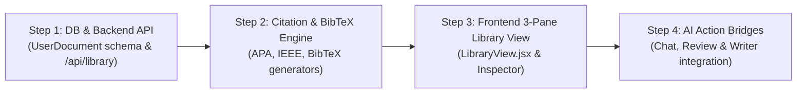

# Feature: Academic Reference Manager & Central Paper Library (F-17)

## 1. Overview
* **Status:** In Design (Decomposed into Step-by-Step Implementation)
* **Priority:** High
* **Module:** Module 4 — Academic Knowledge Base & Reference Management Subsystem

## 2. Purpose
Transforms ScholarsMate from a session-locked RAG chat interface into an **All-in-One Academic Research Workbench** by introducing a central, Zotero-grade Reference Manager and Paper Library. Researchers can organize, inspect, edit, and export bibliographic citations across their entire document collection, while maintaining seamless bidirectional bridges with the RAG Chat, Literature Review Studio, and Assisted Document Writer.

---

## 3. Functional Requirements Breakdown (FR-17.1 to FR-17.8)

### FR-17.1 (Central Document Ledger & Collection Registry)
* **Requirement:** The system shall provide a global library page displaying every paper uploaded by the user across all workspaces in a structured, sortable data table.
* **Fields Displayed:** Title, Authors, Publication Year, Venue/Journal, File Size, Date Added, and Associated Workspaces.
* **Filtering & Sorting:** 
  - Filter by Collection / Workspace.
  - Filter by Custom Tags (e.g. `#Transformer`, `#Evaluation`, `#FYP-Core`).
  - Sort ascending/descending by Title, Author, Year, and Date Added.
  - Real-time search across Title, Authors, and Filenames.

### FR-17.2 (Deep Bibliographic Schema & Metadata Storage)
* **Requirement:** The database model `UserDocument` shall be extended to store complete scholarly metadata:
  - `item_type`: Journal Article, Conference Paper, Preprint (arXiv), Book Chapter, Thesis/Report.
  - `title`: Formal publication title.
  - `authors`: Full author list.
  - `year`: 4-digit publication year.
  - `venue`: Journal or Conference proceedings name.
  - `doi`: Digital Object Identifier (e.g. `10.1145/...`).
  - `arxiv_id`: ArXiv identifier if applicable (e.g. `2305.18290`).
  - `url`: Direct link to publication or publisher page.
  - `abstract`: Author abstract or executive summary.
  - `tags`: User-defined categorizations.
* **Persistence:** Stored in relational SQLite/PostgreSQL with automatic migration.

### FR-17.3 (Automated Bibliographic Extraction & Manual Inspector)
* **Requirement:** When a PDF is ingested, the system shall run layout-aware font extraction (`bibliographic_extractor.py`) to auto-populate metadata.
* **Manual Correction:** The right-hand Inspector pane shall provide inline editable fields allowing the researcher to fix or enrich extracted metadata (e.g., correcting an author name or adding a missing DOI).

### FR-17.4 (Multi-Format Citation Engine & BibTeX Exporter)
* **Requirement:** The system shall format any selected paper into standard academic citation styles:
  - **APA 7th:** `Vaswani, A., et al. (2017). Attention is all you need. NeurIPS.`
  - **IEEE:** `[1] A. Vaswani et al., "Attention is all you need," in NeurIPS, 2017.`
  - **Harvard:** `Vaswani, A. et al. (2017) 'Attention is all you need', NeurIPS.`
  - **MLA 9th:** `Vaswani, Ashish, et al. "Attention Is All You Need." NeurIPS, 2017.`
  - **BibTeX Entry:** Ready-to-copy `@article{...}` or `@inproceedings{...}` block with unique citekey.
* **Bulk Export:** A one-click export button shall generate a clean, downloadable `.bib` file for the entire workspace or selected papers for Overleaf / LaTeX thesis writing.

### FR-17.5 (AI Executive Summary & TL;DR Preview)
* **Requirement:** The Library Inspector shall display the pre-computed 1-paragraph summary (from `UserDocument.summary_cache` / FR-11).
* **Benefit:** Allows researchers to quickly evaluate paper relevance in `< 50ms` without re-reading the PDF or waiting for LLM generation.

### FR-17.6 (Interactive 3-Pane Zotero-Style UI)
* **Requirement:** The Library page shall implement the industry-standard 3-Pane layout:
  - **Pane 1 (Left Sidebar):** Collections (All Papers, Recent, by Workspace, by Tag) + Library navigation.
  - **Pane 2 (Center Grid):** Search bar, bulk action toolbar, and responsive sortable paper data table.
  - **Pane 3 (Right Inspector):** Tabbed drawer with:
    - *Metadata Tab:* Editable bibliographic fields.
    - *AI Summary Tab:* Executive TL;DR and key takeaways.
    - *Citation Tab:* One-click citation copy buttons (APA, IEEE, BibTeX).
    - *Notes Tab:* User research notes attached to this document.

### FR-17.7 (Action Bridge: Library $\rightarrow$ RAG Chat & Literature Review)
* **Requirement:** The Library shall provide direct action shortcuts:
  - **"Chat with Paper":** Opens a new split-screen chat session scoped strictly to that document in Paper Assistant mode.
  - **"Synthesize Literature Review":** Selecting 2 to 6 papers enables a "Synthesize Review" action that opens the Literature Review Studio with those documents pre-selected.

### FR-17.8 (Action Bridge: Library $\rightarrow$ Document Writer)
* **Requirement:** Inside the Assisted Document Writer (`DocumentWriter.jsx`), a slide-out "Library Drawer" shall allow authors to search their library, click a paper, and click **"Insert Citation"**.
* **Behavior:** Inserts `[Author, Year]` at the cursor position and automatically updates the References block at the bottom of the thesis draft.

---

## 4. Technical Implementation & Phased Rollout Plan

### Phase 1: Database & Backend Endpoints
* **Database (`backend/db/models.py`):** Add bibliographic columns (`item_type`, `title`, `authors`, `year`, `venue`, `doi`, `arxiv_id`, `url`, `abstract`, `tags`) to `UserDocument`.
* **CRUD (`backend/db/crud.py`):** Add `get_user_library()`, `update_document_metadata()`, `add_document_tag()`, `export_bibtex()`.
* **API (`backend/api/main.py`):**
  - `GET /api/library`: Returns all documents for the user with metadata, summary, and linked workspaces.
  - `PATCH /api/library/{doc_id}`: Updates metadata and tags.
  - `GET /api/library/export/bibtex`: Generates downloadable `.bib` string.

### Phase 2: Citation Generation Engine
* **File (`backend/ingestion/citation_engine.py`):** Pure deterministic citation generator for APA, IEEE, Harvard, MLA, and BibTeX using the schema fields.

### Phase 3: Frontend 3-Pane Library Page
* **File (`frontend/src/components/library/LibraryView.jsx`):**
  - Collections sidebar.
  - Sortable data table with search & multi-select checkboxes.
  - Inspector drawer with Info, AI Summary, Citation, and Notes tabs.
* **Top Navigation:** Toggle in header/sidebar between "Research Studio" (Chat + Writer) and "Library".

### Phase 4: Workflow Bridges
* Connect Library selection $\rightarrow$ `onOpenPdfViewer`, `onStartChatWithDoc`, `onGenerateLitReview`.
* Connect Document Writer $\rightarrow$ "Insert Citation from Library".

---

## 5. University Mapping
* **SRS Requirement:** FR-17 (Academic Reference Management & Central Paper Library)
* **SDD Component:** Section 4.4 — Bibliographic Engine & Reference Management Subsystem
* **Test Plan:** `backend/tests/test_library.py` (Unit tests for metadata updating, BibTeX generation, and citation formatting).
