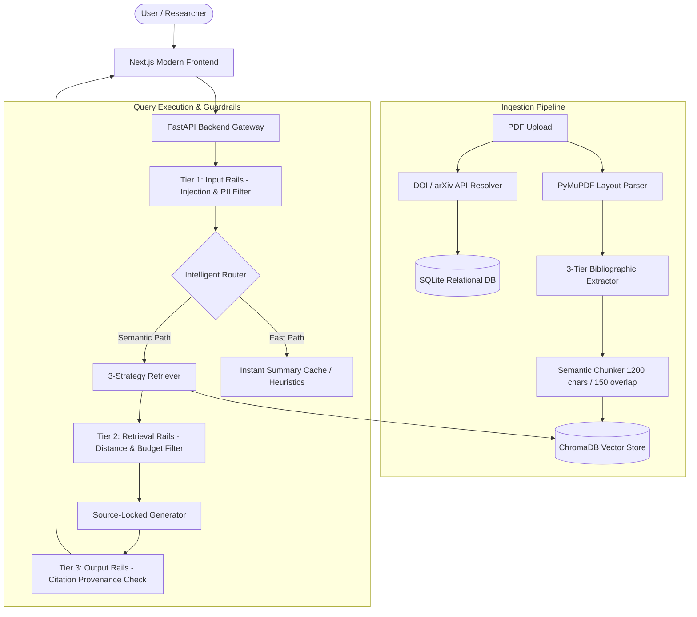

# ScholarsMate 🎓 — Executive Summary & Vision

## What is ScholarsMate?
**ScholarsMate** is an end-to-end, academic-focused **Retrieval-Augmented Generation (RAG) Workbench** designed specifically for university researchers, thesis students, and scholars.

Standard AI assistants (like ChatGPT or vanilla RAG implementations) fail in academic workflows because they:
1. **Hallucinate citations:** Fabricate plausible-looking paper titles, authors, and page numbers.
2. **Lose document context:** Scramble multi-column academic layouts, equations, and tables.
3. **Ignore context economics:** Exceed token rate limits (TPM/RPM) and blow user budgets.
4. **Lack research tools:** Act as ephemeral chat windows without library management, BibTeX exports, or literature matrices.

ScholarsMate solves this by integrating:
- **Layout-Aware PDF Ingestion:** PyMuPDF-based text and metadata extraction preserving structure.
- **Source-Locked RAG Engine:** Strict inline citations `[DocumentName, p. X]` with deterministic provenance verification.
- **3-Tier Defensive Guardrails:** Sub-millisecond defense against prompt injections, token overflows, and citation hallucinations.
- **Zotero-Grade Reference Manager:** Central paper repository with automatic DOI/arXiv metadata resolution, duplicate detection, and citation formatting.
- **Autonomous Brain Memory:** Long-term cross-session memory tracking research interests and user preferences.
- **Literature Review Monograph Studio:** 5-stage synthesis pipeline generating publication-grade comparative matrices and monographs.

---

## The Core Philosophy: "Source-Locked Evidence"
> *"An academic assistant must never claim what it cannot trace directly to a verified page."*

Every response generated by ScholarsMate is bound to physical ground truth. If a statement cannot be grounded in the user's uploaded workspace papers, the system either:
1. Explicitly disclaims the information as general conceptual background, or
2. Refuses to fabricate a citation, flagging unverified claims via our Output Rails.

---

## High-Level System Architecture

---

## Linked Notes
- [[01_System_Architecture_Overview]] — Complete component interaction
- [[02_Tech_Stack_Rationale]] — Why FastAPI, Next.js, ChromaDB, and SQLite
- [[30_Source_Locked_Generation]] — Prompt architecture and citation rules
- [[31_Multi_Tier_Defensive_Guardrails]] — The 3-Tier safety harness
