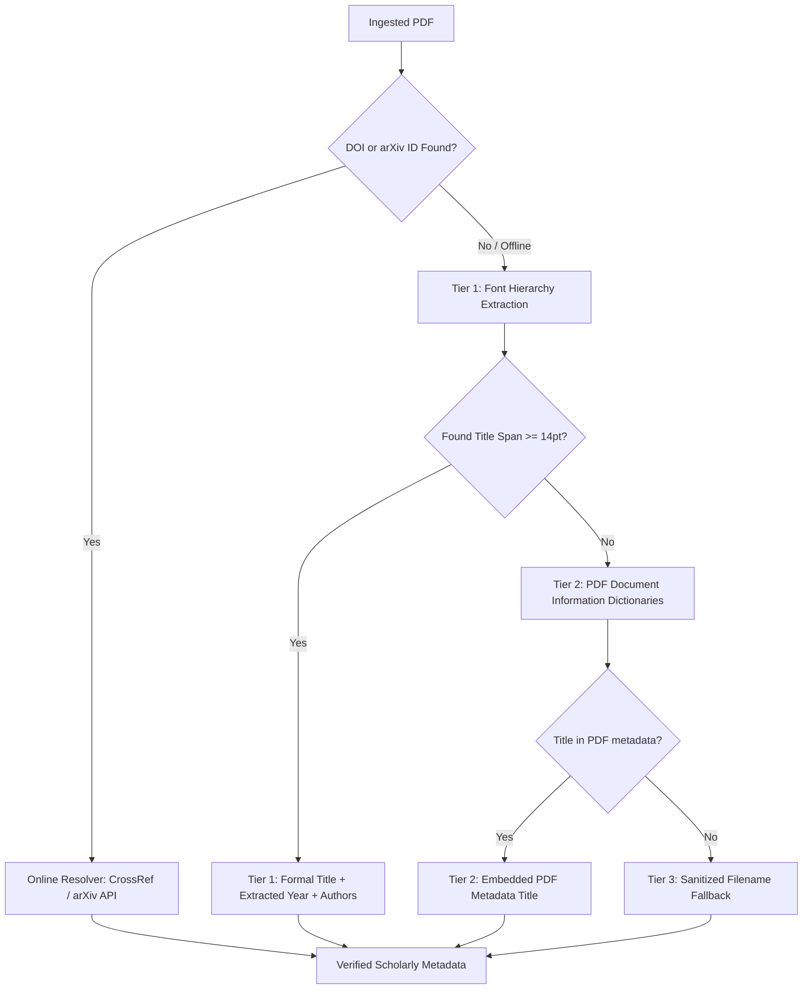

# Bibliographic Metadata Extraction (3-Tier Graceful Degradation)

## Purpose & Problem Statement
In an academic library, papers rarely have clean filenames. A researcher's download folder is filled with filenames like:
- `2305.18290v2.pdf`
- `main (4).pdf`
- `s41586-020-2649-2.pdf`
- `final_thesis_draft_revised.pdf`

If an assistant cites `[2305.18290v2.pdf, p. 3]`, it looks cryptic and amateur. ScholarsMate implements a **3-Tier Graceful Degradation Strategy** (`backend/ingestion/bibliographic_extractor.py`) combined with automated identifier resolution to obtain formal scholarly metadata.

---

## 3-Tier Degradation Architecture



### Tier 1: True Academic Paper (Font Span Hierarchy)
- Analyzes text blocks on Page 1.
- Identifies the highest font-size span (excluding university logos and headers).
- Extracts publication year via regex matching `(19[7-9]\d|20[0-3]\d)`.
- Strips academic titles (Dr., Prof., PhD) and affiliation email addresses.

### Tier 2: Document Metadata Properties
- Inspects the internal PDF dictionary: `/Title`, `/Author`, `/CreationDate`.
- If valid and non-generic (e.g. not `"Microsoft Word - Document1"`), accepts it as Tier 2.

### Tier 3: Cleaned Filename Fallback
- Converts raw filenames like `lecture_04_deep_learning_nlp.pdf` into title case:
  `Lecture 04 Deep Learning Nlp`.
- Guarantees the system never crashes or returns empty strings.

---

## Code Reference (`bibliographic_extractor.py`)
```python
def extract_bibliographic_metadata(pdf_path: str) -> Dict[str, Any]:
    # Check in-memory LRU cache first
    if path_str in _METADATA_CACHE:
        return _METADATA_CACHE[path_str]
        
    # Tier 1: Visual layout and font analysis
    t1 = _extract_tier1_academic(doc)
    if t1:
        return t1
        
    # Tier 2: Embedded metadata
    t2 = _extract_tier2_docinfo(doc)
    if t2:
        return t2
        
    # Tier 3: Filename sanitization
    return _extract_tier3_filename(pdf_path)
```

---

## Linked Notes
- [[41_DOI_and_arXiv_Identifier_Resolvers]] — Real-time CrossRef & arXiv resolution
- [[40_Academic_Reference_Manager_Overview]] — How metadata populates the Library
- [[12_Semantic_Chunking_Strategy]] — Injecting metadata into vector chunks
