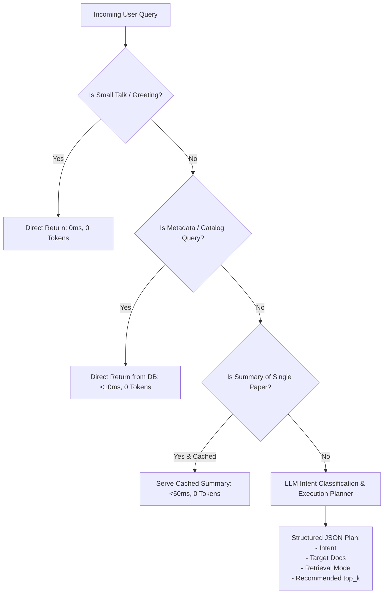

# Fast-Path Heuristics vs. LLM Structured Planner

A core architectural achievement of ScholarsMate is balancing **latency, monetary/token cost, and planning depth**.



---

## 1. Fast-Path Heuristics (`runtime.py:heuristic_intent`)
Runs deterministic regex matching in $< 1\text{ms}$:
- **Greetings:** `hello`, `hi`, `hey`, `good morning`, `who are you`.
- **Workspace Metadata:** `how many papers`, `list files`, `show workspace`.
- **Cached Summaries:** `summarize paper`, `tl;dr`, `what is this paper about`.

### The Benefit:
Over **30% - 40% of queries** in realistic user sessions hit one of these fast paths. By skipping vector search and secondary LLM routing calls, the system preserves user rate limits and provides instant responses.

---

## 2. LLM Structured Planner (`router.py:classify_query_intent`)
When heuristics do not match, the query is passed to an ultra-fast model (e.g. `gemini-2.5-flash` or `groq/llama-3.3-70b-versatile`) with a strict JSON system prompt.

The LLM returns an execution contract:
```json
{
  "intent": "NEW_QUERY",
  "scope": "subset",
  "target_docs": ["vaswani2017.pdf", "devlin2018_bert.pdf"],
  "retrieval_mode": "per_document_search",
  "query_depth": "broad_synthesis",
  "recommended_top_k": 8
}
```

### Plan Sanitization (`sanitize_plan`):
The raw JSON plan is passed through a deterministic validation barrier:
1. Validates that `target_docs` exist in the active workspace.
2. Adjusts `recommended_top_k` based on document count.
3. Overrides the mode to `cached_summary` if a pre-computed summary exists.

---

## Linked Notes
- [[20_Intelligent_Query_Router]] — Router architecture overview
- [[64_Token_Economics_and_Free_Tier_Viability]] — How this protects free-tier limits
- [[23_Retrieval_Strategies_and_Token_Budget]] — How the plan is executed
