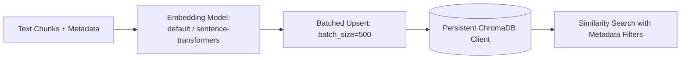

# ChromaDB Vector Persistence & Tenant Scoping

## The Storage Layer Architecture (`backend/embeddings/vector_store.py`)
ScholarsMate uses **ChromaDB** as its persistent vector search engine. It runs in-process with SQLite storage under `./chroma_db/`.



---

## 1. Thread-Safe Singleton Pattern
To prevent SQLite database lock contention and excessive file handles, ChromaDB is managed via a thread-safe singleton:
```python
_client = None
_collections = {}

def get_chroma_client():
    global _client
    if _client is None:
        _client = chromadb.PersistentClient(path="./chroma_db")
    return _client
```

---

## 2. Batched Upserting (Preventing SQLite Variable Limit)
SQLite has a hard limit of 999 to 32,766 bound query parameters. Ingesting large 100-page monographs produces hundreds of chunks with rich metadata dictionaries.

To prevent parameter overflow, ScholarsMate batches upserts:
```python
def store_chunks(chunks: List[Document], collection_name: str = "scholars_docs"):
    collection = get_collection(collection_name)
    batch_size = 500
    for i in range(0, len(chunks), batch_size):
        batch = chunks[i : i + batch_size]
        collection.upsert(
            ids=[c.metadata["chunk_id"] for c in batch],
            documents=[c.page_content for c in batch],
            metadatas=[c.metadata for c in batch]
        )
```

---

## 3. Strict Metadata Filtering & Tenant Isolation
When querying, ChromaDB supports SQL-like boolean metadata expressions. ScholarsMate scopes queries to the specific documents and active user:
```python
# Multi-document filter
where_clause = {
    "$and": [
        {"user_id": {"$eq": user_id}},
        {"doc_name": {"$in": target_docs}}
    ]
}
```
This guarantees that **no user can ever retrieve chunks from another user's private workspace**, achieving multi-tenant privacy with zero cloud infrastructure.

---

## Linked Notes
- [[60_ChromaDB_vs_Cloud_Vector_Databases]] — Tradeoffs vs Pinecone
- [[12_Semantic_Chunking_Strategy]] — Chunk structure and metadata fields
- [[23_Retrieval_Strategies_and_Token_Budget]] — How search queries ChromaDB
