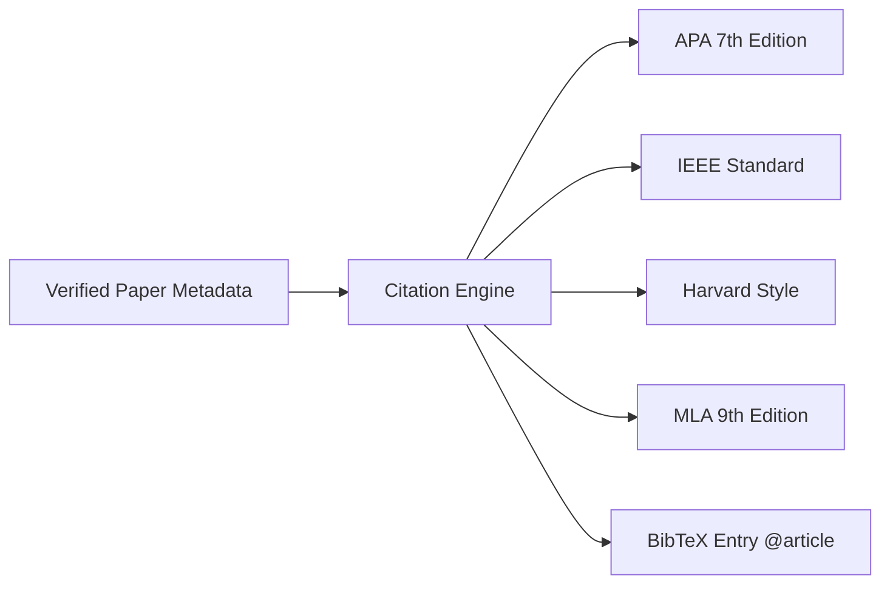

# Multi-Format Citation Engine & BibTeX Exporter

## Purpose & Requirements
* **SRS Requirement:** FR-17.4 (Multi-Format Citation Engine & BibTeX Exporter)
* **Code Location:** `backend/ingestion/citation_engine.py`

Academic writing requires switching between different citation standards (e.g. IEEE for engineering, APA for social sciences, BibTeX for LaTeX/Overleaf). ScholarsMate includes a deterministic, formatting engine generating compliant citations with zero LLM hallucinations.

---

## Supported Citation Standards



### 1. APA 7th Edition
> Vaswani, A., Shazeer, N., Parmar, N., Uszkoreit, J., Jones, L., Gomez, A. N., Kaiser, Ł., & Polosukhin, I. (2017). *Attention is all you need*. Advances in Neural Information Processing Systems (NeurIPS).

### 2. IEEE Standard
> [1] A. Vaswani et al., "Attention is all you need," in *Advances in Neural Information Processing Systems (NeurIPS)*, 2017.

### 3. BibTeX Clean Block Generator
```bibtex
@inproceedings{vaswani2017attention,
  author    = {Vaswani, Ashish and Shazeer, Noam and Parmar, Niki and Uszkoreit, Jakob and Jones, Llion and Gomez, Aidan N. and Kaiser, {\L}ukasz and Polosukhin, Illia},
  title     = {Attention is All You Need},
  booktitle = {Advances in Neural Information Processing Systems (NeurIPS)},
  year      = {2017},
  doi       = {10.48550/arXiv.1706.03762}
}
```

---

## Bulk `.bib` Export for Overleaf / LaTeX
From the Library page or workspace toolbar, researchers can click **"Export BibTeX"**:
- Generates a clean, downloadable `references.bib` file for all selected papers or an entire workspace collection.
- Citekeys are generated deterministically using author surname + year + first title word (e.g. `vaswani2017attention`), preventing collisions.
- Ready to upload directly into Overleaf or compile with `biblatex`.

---

## Linked Notes
- [[40_Academic_Reference_Manager_Overview]] — Library UI Inspector
- [[52_Assisted_Document_Writer_and_Citation_Drawer]] — Inserting citations into live thesis drafts
- [[41_DOI_and_arXiv_Identifier_Resolvers]] — Metadata source
