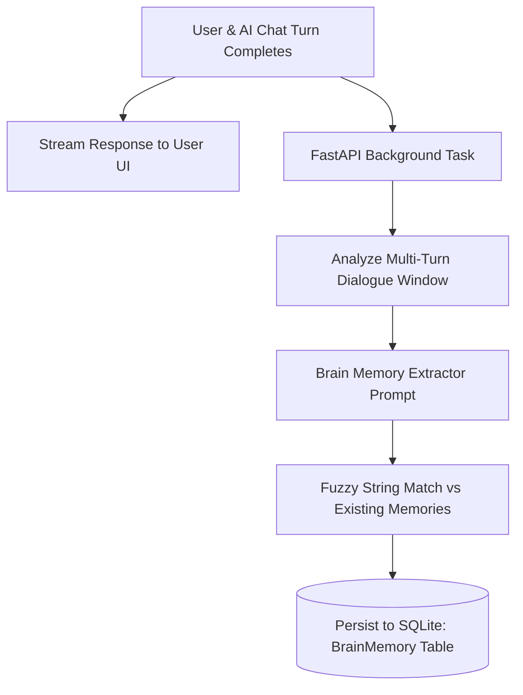

# Autonomous Brain Memory Subsystem (F-15)

## Purpose: Continuity Across Research Sessions
Standard chat systems have amnesia: the moment a user creates a new session, the AI forgets who they are, what their FYP is about, what citation style they prefer, and what decisions they made yesterday.

ScholarsMate introduces the **Autonomous Brain Memory Subsystem** (`backend/rag/brain.py` and `backend/db/models.py:BrainMemory`).

---

## 1. Asynchronous Extraction (Non-Blocking)
Brain extraction runs in the background via FastAPI's `BackgroundTasks`, imposing **zero latency penalty** on the user's active chat turn.



---

## 2. Memory Ontology & Scoping
Memories are strictly classified into scopes and categories:

### Scopes:
- **`global`:** Applies across all workspaces (e.g. user profile, degree level, institutional affiliation, preferred citation style).
- **`workspace`:** Scoped strictly to the active workspace (e.g. project decisions, chosen baseline models, benchmark targets).

### Categories:
1. `profile`: *"User is a Final Year CS Bachelor's student working on their FYP."*
2. `preference`: *"Prefers IEEE citation formatting and concise bulleted explanations."*
3. `directive`: *"Always highlight algorithmic complexity in Big-O notation."*
4. `milestone`: *"Committed to using ChromaDB rather than cloud Pinecone for data privacy."*
5. `insight`: *"Found that Llama-3.3-70B requires strict top_k=4 to avoid TPM limits."*

---

## 3. Dynamic Context Injection
When generating new RAG answers:
- The system fetches active memories (`is_active=True`).
- Injects a compact memory block into the system prompt:
  ```markdown
  ### RESEARCHER CONTEXT & PREFERENCES (BRAIN MEMORY):
  - User is working on their Bachelor's Final Year Project (ScholarsMate).
  - Prefers IEEE citation styling.
  - Architecture uses PyMuPDF layout parsing and ChromaDB.
  ```
- Result: The assistant naturally speaks the user's technical dialect without repetitive briefing!

---

## Linked Notes
- [[30_Source_Locked_Generation]] — How memories are injected into prompts
- [[64_Token_Economics_and_Free_Tier_Viability]] — Capping memories to prevent token bloat
- [[01_System_Architecture_Overview]] — Data model relations
