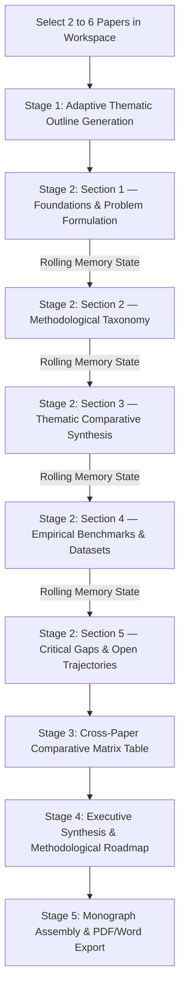

# Literature Review Monograph Studio & Matrix Generator

## The Problem: Generating Comprehensive Literature Reviews
Writing Chapter 2 (Related Work / Literature Review) of a thesis is one of the most grueling tasks for university students. Trying to prompt ChatGPT with 10 PDFs causes:
1. Severe context truncation.
2. Shallow, repetitive prose.
3. Loss of thematic structure across papers.

ScholarsMate features an automated **5-Stage Literature Review Studio** (`backend/rag/literature_review.py`).

![[assets/act_matrix.png]]

---

## The 5-Stage Monograph Generation Pipeline

---

## 1. Rolling Memory State (`rolling_memory`)
To prevent subsequent sections from repeating arguments made earlier, each section generator receives a rolling 250-word synthesis of prior sections. This ensures **tight narrative cohesion across the entire 4,000-word monograph**.

---

## 2. Automated Literature Matrix Generation
The system builds a publication-grade Markdown comparative matrix evaluating all papers across 6 canonical dimensions:
- **Core Methodology / Model Architecture**
- **Primary Research Focus & Theoretical Foundation**
- **Datasets & Evaluation Baselines**
- **Quantitative Results & Breakthrough Metrics**
- **Key Architectural Tradeoffs**
- **Critical Limitations & Unaddressed Gaps**

### Example Output Table:
| Paper | Method / Architecture | Benchmark Datasets | Key Performance Metric | Critical Limitation |
|---|---|---|---|---|
| **Vaswani et al. (2017)** | Multi-Head Self-Attention Transformer | WMT 2014 En-De, En-Fr | 28.4 BLEU (En-De), 41.8 BLEU (En-Fr) | Quadratic $O(N^2)$ attention memory complexity on long contexts |
| **Devlin et al. (2018)** | Masked Language Model (BERT) | GLUE Benchmark, SQuAD v1.1 | 80.5% Average GLUE Score | High pretraining computational requirements; unidirectional generation limitation |

---

## Linked Notes
- [[40_Academic_Reference_Manager_Overview]] — Synthesizing reviews directly from Library
- [[52_Assisted_Document_Writer_and_Citation_Drawer]] — Exporting to Document Writer
- [[33_Paper_Assistant_vs_Deep_Research]] — Multi-document synthesis modes
