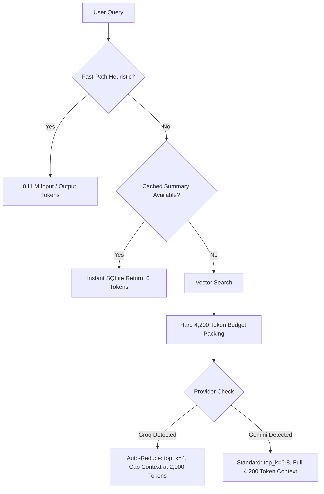

# Token Economics & Free-Tier Optimization

> **Key Presentation Question:** *"How does ScholarsMate operate on free-tier LLM providers (Groq, Gemini Flash) without crashing or running out of tokens?"*

---

## The Economics Problem in RAG Systems
Academic papers are massive documents (typically 5,000 to 20,000 words each). A naive multi-paper RAG query easily loads 15,000+ input tokens.

### Free-Tier Provider Limits:
- **Groq Free Tier (`llama-3.3-70b-versatile`):**
  - **Tokens Per Minute (TPM):** ~6,000 TPM
  - **Requests Per Minute (RPM):** ~30 RPM
  - **Context Window:** 128k
  - *Risk:* A single unoptimized multi-paper turn (~8,000 tokens) causes an immediate HTTP 429 Rate Limit Crash!
- **Gemini Free Tier (`gemini-2.5-flash` / `gemini-3.6-flash`):**
  - **Context Window:** 1,000,000 tokens
  - **Rate Limit:** 15 RPM / 1M TPM
  - *Advantage:* Highly stable for deep literature review synthesis.

---

## How ScholarsMate Engineers Token Viability

### 1. Zero-Token Short-Circuiting
- Greetings and conversational small talk bypass LLM calls entirely.
- Workspace metadata queries (`how many papers`) read directly from database counts.
- Summary queries hit the pre-computed SQLite cache (`summary_cache`).

### 2. Provider-Aware Dynamic Throttling
- When a Groq API key is active, ScholarsMate automatically adapts:
  - Caps retrieval at `top_k=4` chunks.
  - Drops prompt context ceiling from 4,200 to 2,000 tokens.
  - Skips non-essential query expansion LLM calls.
- When Gemini Flash is active, full multi-doc synthesis is enabled.

---

## Linked Notes
- [[23_Retrieval_Strategies_and_Token_Budget]] — Token packing logic
- [[21_Fast_Path_Heuristics_vs_LLM]] — Heuristics breakdown
- [[13_Ingestion_Time_Document_Cache]] — Summary caching
